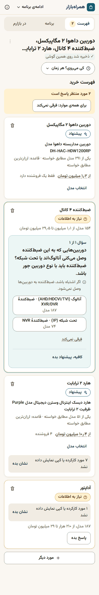
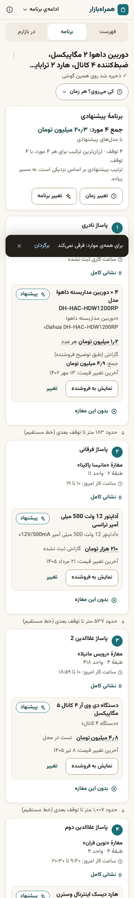
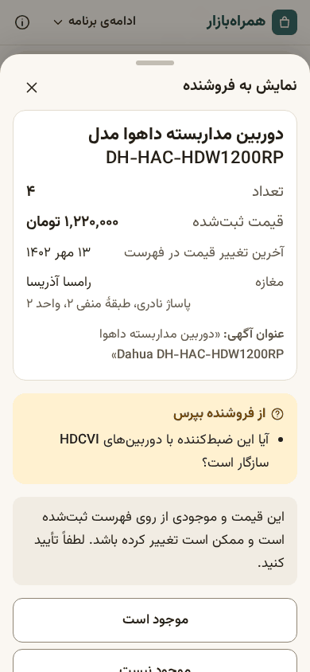
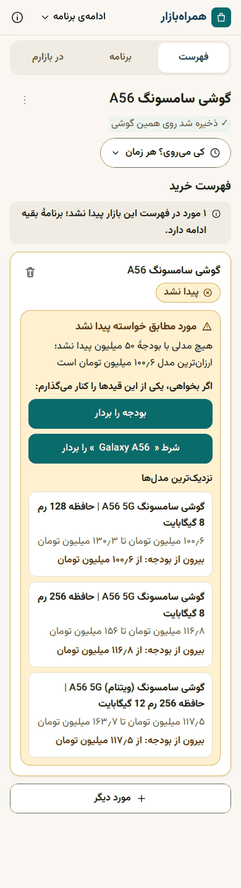

# Bazaar Companion (همراه‌بازار)

A Persian, mobile-first assistant that turns a shopping sentence into a **plan for an in-person shopping run** in
Tehran's bazaar belt (Ferdowsi, Sheikh Hadi, Baharestan): which products, from which shops, in which malls and
floors, in what order, at what price, and whether the shops are open when you go. Built for the Torob hackathon on
the organisers' marketplace dataset (snapshot of 13 Oct 2026 = 21 Mehr 1405).

> **Live demo:** http://87.107.5.78:8088 (Docker on a VPS; open it on a phone or in a 390 px browser window). Deployment details: [docs/DEPLOY.md](docs/DEPLOY.md).

Persian summary for judges: [خلاصهٔ فارسی](#خلاصهٔ-فارسی). Five-minute demo script (Persian) and judge crib sheet:
[docs/DEMO.md](docs/DEMO.md).

<p>
  
  
  
  
</p>

(Real screenshots at 390x844 against the real database; more in [docs/screenshots](docs/screenshots).)

## The problem

Buying for a project in a bazaar (a CCTV install, an electrical job, a phone with its accessories) means several
items, many malls, and a lot of guessing:

- Which of 300 near-identical cameras is the right one, and is it compatible with the recorder, the hard drive and the
  adapter I also need?
- Which shops should I visit so the whole list is covered with the fewest stops and the lowest total?
- Is that shop open on a Friday evening? (Very few are.)
- The price is per metre or per 100 m roll? The shop does not have it? Now what?

Online listings help with prices but not with the trip. Bazaar Companion plans the trip, says plainly what it
knows and what it only assumes, and keeps working when the shop says "we don't have it".

## What makes it different (mapped to the judging criteria)

| Criterion | What to look at |
|---|---|
| **Product usefulness** | One sentence in, a complete shopping run out: exact subset-DP planner picks stops (malls) so that the list is **covered first**, then offers the Pareto set of **cost x number of stops**. Shows hours for the chosen day/time, straight-line distance between stops, per-item prices and warranty, and a show-to-seller card for use in the shop. |
| **UX** | Persian-first, RTL, 390 px mobile. No account, no confirmation screen. Two screens plus sheets; three views (list / plan / in the market). At most one question card is open at a time. Autosave on the device, resume card, share link. Touch targets >= 48 px, bidi-safe model codes, Persian digits and Jalali dates. |
| **AI follow-up** | Plan assistant («تغییر برنامه»): chips or free text become **one action from a closed set** (cheaper, closer, fewer stops, only open shops, drop a shop or mall, swap brand, relax a constraint, ...), applied to the *requirement state*, then the plan is recomputed and the **diff is shown with undo**. In the market, «موجود نیست» / «قیمت فرق دارد» triggers a replan with the reason. The LLM never touches prices, products or the plan. |
| **Deployment** | One Docker image (Fastify API + built web app + read-only SQLite), `compose.yaml`, deploy / smoke / rollback scripts, health check, hardened container, optional Caddy with automatic HTTPS. Works offline-shell: a reload with the server down still opens saved plans. See [docs/DEPLOY.md](docs/DEPLOY.md). |
| **Technical** | Deterministic engine in a pure TypeScript package (`packages/core`), shared by the data build and the server. 1,003 tests pass (52 suites run without the dataset, 6 more need it), property tests for the planner and the compatibility guard, a 61-request suggestion-quality audit on real data ([docs/AUDIT-suggestions.md](docs/AUDIT-suggestions.md)), security review of the public endpoint and the LLM layer ([docs/SECURITY.md](docs/SECURITY.md)). |
| **Dataset transparency** | Every figure traces to a dataset field or a labelled rule. Listing-stated facts, general assumptions and unknowns are visibly different («طبق عنوان آگهی» / «فرض عمومی؛ تأیید نشده» / «نامشخص»; never a green tick). Totals always carry their coverage. Used, refurbished and replica listings are never auto-picked. User reports («گزارش شما») stay on the device and never enter dataset totals. See [docs/DATA-TRANSPARENCY.md](docs/DATA-TRANSPARENCY.md). |

## User journeys

1. **Project list.** Type «۴ دوربین داهوا ۲ مگاپیکسل، ضبط‌کننده ۴ کانال، هارد ۲ ترابایت و آداپتور». Items are parsed
   inline. The app asks only what changes the purchase: whether the cameras are analog or IP (so the recorder fits),
   then the adapter voltage (cameras usually take 12 V, shown as an assumption). Cameras and the hard drive need no
   questions: they get a labelled suggestion by a visible rule («ارزان‌ترین مطابق خواسته»).
2. **Plan.** Stops grouped by mall and floor, products with the listing's own title, totals with coverage («جمع ۴ مورد
   ... با مدل‌های پیشنهادی»), a compatibility block, and the real trade-offs («۱٫۸ میلیون تومان بیشتر، ۲ توقف کمتر»).
3. **When to go.** Day and optional time. Closed stops are dropped from the plan with a sentence saying so. Shops with no
   recorded hours are never called closed.
4. **In the market.** Check items off, show the seller a large card (title as listed, quantity, recorded price, the
   compatibility questions to ask), and report «موجود نیست» / «قیمت فرق دارد». The plan is recomputed with a diff and
   «برگرداندن».
5. **Hard cases.** A request nothing matches («گوشی سامسونگ A56 زیر ۵۰ میلیون») explains why, shows the nearest models and
   offers buttons to relax a constraint. A truly absent item («برنج هاشمی») is «پیدا نشد» and the rest of the plan goes on.
   A loose wire request asks the sale unit (roll or metre) before it totals anything.
6. **Continue later.** Plans autosave on the device; the home screen shows a resume card; a link moves a plan to another
   phone with no account.

## Architecture in 10 lines

1. Browser (React + Tailwind, RTL) keeps the whole requirement state; the server is **stateless**.
2. `POST /api/parse`: text to items. A deterministic parser always runs; an optional LLM refinement may improve it within
   a 3 s budget (a late answer is discarded, never swapped in).
3. `POST /api/resolve`: per item, FTS candidates, constraint check (pass / fail / unknown), item state, next question.
4. `POST /api/plan`: exact subset DP over buildings, Pareto on (cost, stops) at maximal coverage, hours filter, compat check.
5. `POST /api/options`, `POST /api/assist`, `GET /api/meta`, `GET /api/health` complete the surface.
6. **The deterministic engine decides** what is eligible, picked, priced and planned. **The LLM only interprets words**
   (parse refinement; assistant action from a closed enum; short explanations after a post-check).
7. All questions, reasons, compatibility sentences and errors are templated Persian, so the product is complete with the LLM off.
8. Data: a read-only SQLite file (about 130 MB) built offline from the provided CSVs; FTS5 over normalised titles.
9. Attributes (megapixels, channels, TB, volts, wire section, phone model, ...) are read from titles; unreadable stays unknown.
10. Details: [docs/ARCHITECTURE.md](docs/ARCHITECTURE.md).

## Honest limitations

- **Snapshot, not live.** Prices are from the 13 Oct 2026 listing; they may have changed. A listing is not stock: a shop
  registered the item, nothing more. The UI says so on every plan.
- **Partial coverage.** The app's own "about the data" sheet says the dataset covers about 10 % of Tehran's shops, in
  the Ferdowsi / Sheikh Hadi / Baharestan area (a figure from the project plan; we cannot verify it from the data alone).
  The data holds 6,476 shops, 3,792 of them with offers, 225,903 products and 331,506 offers.
- **Fictional shop names.** The dataset's shop names are not real (the dataset note says the organisers may have
  fictionalised them); addresses and coordinates are real. Phone numbers, Instagram and websites are not shipped.
- **Compatibility rules are general assumptions**, encoded for CCTV and phone accessories only, and labelled «فرض عمومی؛
  تأیید نشده». We cannot verify them from the data. Elsewhere no compatibility claim is made.
- **Attribute extraction reads titles.** Only about 59 % of camera titles state megapixels and 49 % the signal type; 29 %
  of wire titles state the sale unit. Missing means unknown, never guessed; unknown items are never auto-picked when the
  attribute matters.
- **Distances are straight lines**, stop order is a suggested order, not a walking route. Floor and unit are parsed from
  free-text addresses for about 66 % of shops; the full address is one tap away.
- **The LLM is optional.** With no key, parsing and the assistant's chips are deterministic; typed free text goes through a
  keyword fallback and may not be understood. No LLM key was available during development; the LLM layer is tested with
  fakes and, for local runs only, with the `claude-cli` backend below.
- **Deployed over plain HTTP on a shared VPS** (Docker, port 8088, no domain/TLS yet): the offline service worker and
  the clipboard API need a secure origin, so on the demo URL they fall back or stay inactive; put it behind HTTPS
  (`--proxy` + `DOMAIN`, [docs/DEPLOY.md](docs/DEPLOY.md)) for the full experience.
- No independent Persian-speaker review or first-time-user test is recorded in this repository; the copy has not been
  validated with outside users.

## Run locally

Requires Node 22 or newer. **The dataset is not in the repository.** The organisers' CSV folder
(`starcoach-dataset-v16-cap300-csv/` with `shops.csv`, `products.csv`, `offers.csv`) is expected next to the repo or
passed with `--csv-dir`.

```bash
npm install

# 1. build the database from the provided CSVs (about 35 s), then run the quality gates
npm run data:build -- --csv-dir /path/to/starcoach-dataset-v16-cap300-csv     # writes data/market.sqlite
npm run data:check                                                           # writes data/quality-report.json

# 2. build the web app and start the API + web server on http://localhost:8080
cp .env.example .env                       # optional; every setting has a default
npm run build -w @app/web
npm run dev:server

# UI-only development with hot reload (no database needed): http://localhost:5173/?mock=1
npm run dev:web
```

`data/market.sqlite` and `data/quality-report.json` are git-ignored. If the file is missing the server still starts and
`/api/health` reports `"db": false`. The LLM is off unless `LLM_API_KEY` is set (see `.env.example`).

Slice for quick experiments: `npm run data:build -- --csv-dir ... --limit-products 2000`.

### LLM during development (testing only)

Production uses the Anthropic API with `LLM_API_KEY`. For local tests without a key, `LLM_BACKEND=claude-cli` drives
headless Claude Code sessions with the developer's own login. It is **dev-only**: refused at start-up under
`NODE_ENV=production`, no tools, no repository access, same validation and fallbacks as the API client (see
[docs/SECURITY.md](docs/SECURITY.md) section 5). Smoke tests: `npm run llm:smoke -w @app/server` (API key) and
`npm run llm:smoke:cli -w @app/server` (CLI).

## Deploy with Docker

One container, one read-only SQLite file mounted at `/data`. Short version:

```bash
cp .env.example .env
deploy/push-data.sh --host user@your-vps       # database -> VPS (checksum verified)
deploy/remote-up.sh --env-file .env --proxy    # sync source, build image, start app + Caddy, wait healthy
deploy/smoke.sh https://your-domain            # health, meta, parse -> resolve -> plan, Persian page
```

Everything else (no-domain setup, nginx, `TRUST_PROXY`, data updates, rollback, baking the database into the image with
`DATA_URL`) is in [docs/DEPLOY.md](docs/DEPLOY.md) and `deploy/rollback.md`. Measured locally with the real database:
image 234 MB, about 85 MB RAM, healthy in about 7 s. The database must not be published unless the dataset licence
allows it.

## Tests

```bash
npm test                                                    # vitest, all workspaces (831 tests without the dataset)
DATABASE_PATH=data/market.sqlite npm test                   # + real-data suites: 1,003 tests
npm run typecheck
npm run e2e -w @app/web                                     # Playwright UI smoke (mock engine)
npm run e2e:real -w @app/web                                # Playwright on the built server + real database
```

`e2e:real` (26 specs, each run at 390x844 and 360x640) builds the web app and the server, starts the built server on a
free port and drives the real UI: the CCTV journey end to end (question, plan, Friday, show-to-seller, report, replan,
undo, reload, resume), wire sale unit, absent and present categories, share link, dead ends, bidi, offline shell. Set
`E2E_DB=/path/to/market.sqlite` (the default path is a developer machine). Install a browser once with
`npx playwright install chromium`. `npm run shots -w @app/web` regenerates screenshots; `npm run audit:suggestions
-w @app/server` reproduces the suggestion-quality audit; `npm run labels -w @app/data` reproduces the extraction
accuracy report.

## Repository layout

```
packages/core     pure logic: normalisation, attribute extractors, requirement model + item states, compatibility
                  rules, question engine, exact planner, API types and Persian copy (shared by data build and server)
apps/server       Fastify API + static web: parse (deterministic + optional LLM), retrieval (FTS), engine adapter,
                  assistant, LLM client / gate / breaker, health, security headers, rate limits
apps/web          React + Vite + Tailwind PWA shell (RTL, Vazirmatn), screens, sheets, local persistence, share link,
                  Playwright suites (e2e, e2e-real), real screenshots
scripts/data      CSV -> market.sqlite build, cleaners (price, hours, address), quality gates and report, labelled samples
deploy/, docker/  VPS deploy, smoke and rollback scripts; build-time data fetch
docs/             PLAN, ARCHITECTURE, DATA-TRANSPARENCY, DATA_SCHEMA, SECURITY, DEPLOY, DEMO, AUDIT-suggestions, CONTRACTS
conductor*/       tooling used to orchestrate the AI-assisted development of this repo (not part of the product)
```

## خلاصهٔ فارسی

**همراه‌بازار** یک دستیار موبایل‌محور فارسی برای برنامه‌ریزی خرید حضوری در بازار تهران (محدودهٔ فردوسی، شیخ‌هادی و
بهارستان) است. کاربر فهرست خریدش را با یک جمله می‌نویسد، مثلاً «۴ دوربین داهوا ۲ مگاپیکسل، ضبط‌کننده ۴ کانال، هارد ۲
ترابایت و آداپتور»، و برنامهٔ رفتن را می‌گیرد: کدام مغازه، کدام پاساژ و طبقه، با چه ترتیبی، به چه قیمتی، و آیا آن
مغازه در روز و ساعت دلخواه باز است.

**چه چیزی متفاوت است**

- **موتور قطعی تصمیم می‌گیرد، مدل زبانی فقط حرف‌ها را می‌فهمد.** انتخاب کالا، قیمت، برنامه و سازگاری همه از موتور
  قطعی می‌آید؛ مدل زبانی اختیاری است و بدون آن هم همه‌چیز کار می‌کند.
- **صداقت دربارهٔ داده.** هر پیشنهاد «پیشنهاد» نامیده می‌شود نه «مدل مشخص»؛ سازگاری سه سطح دارد: «طبق عنوان آگهی»،
  «فرض عمومی؛ تأیید نشده» و «نامشخص». جمع قیمت همیشه می‌گوید چند مورد را پوشش داده است. فهرست بودن کالا یعنی مغازه آن
  را ثبت کرده، نه اینکه موجود باشد.
- **برنامهٔ دقیق.** کمترین هزینه برای پوشش کامل فهرست، همراه با گزینه‌هایی که توقف کمتری دارند و تفاوتشان به تومان
  گفته می‌شود. مغازه‌های بسته در روز و ساعت انتخابی از برنامه کنار گذاشته می‌شوند.
- **در بازار.** کارت «نمایش به فروشنده»، گزارش «موجود نیست» یا «قیمت فرق دارد»، جایگزینی خودکار با نمایش تفاوت و
  «برگرداندن». گزارش‌های کاربر فقط روی همان گوشی می‌مانند و جزو داده‌ی رسمی نیستند.
- **بدون حساب کاربری.** ذخیرهٔ خودکار روی دستگاه، کارت «ادامه‌ی برنامه‌ی قبلی» و پیوند اشتراک‌گذاری.

**محدودیت‌ها**

- قیمت‌ها مربوط به ۲۱ مهر ۱۴۰۵ است و ممکن است عوض شده باشند؛ موجودی تأیید نشده است.
- داده حدود ۱۰٪ مغازه‌های تهران را پوشش می‌دهد (عددی که در برنامهٔ پروژه آمده و از خود داده قابل تأیید نیست).
  نام مغازه‌ها در داده ساختگی است ولی آدرس و موقعیت واقعی است.
- قواعد سازگاری فرض‌های عمومی‌اند (فقط برای دوربین مداربسته و لوازم جانبی گوشی) و از روی داده قابل تأیید نیستند.
- ویژگی‌ها از روی عنوان آگهی خوانده می‌شوند؛ اگر چیزی خوانده نشود «نامشخص» می‌ماند و حدس زده نمی‌شود.
- فاصله‌ها خط مستقیم‌اند و ترتیب توقف‌ها مسیر پیاده نیست.

**اجرا و استقرار.** مجموعه‌داده در مخزن نیست؛ پایگاه‌داده از فایل‌های CSV سازمان‌دهندگان ساخته می‌شود
(`npm run data:build`). راهنمای کامل اجرا و استقرار با داکر در بخش‌های بالا و در `docs/DEPLOY.md` آمده است.
سناریوی دموی پنج‌دقیقه‌ای در `docs/DEMO.md` است.
