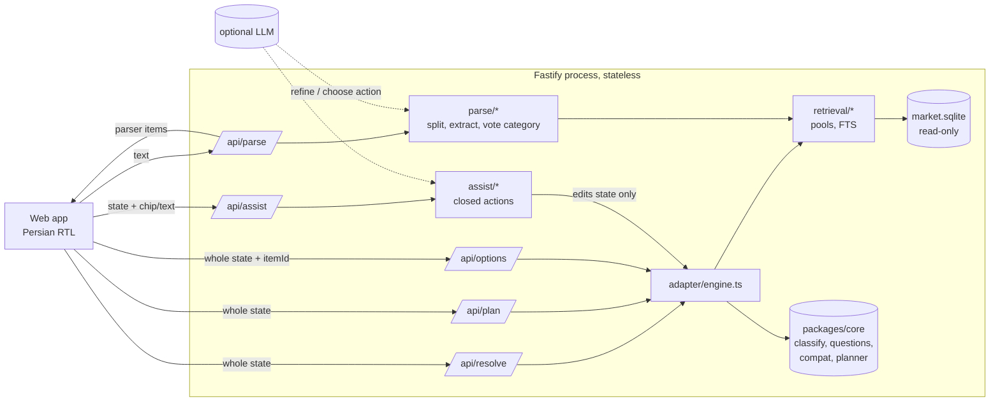
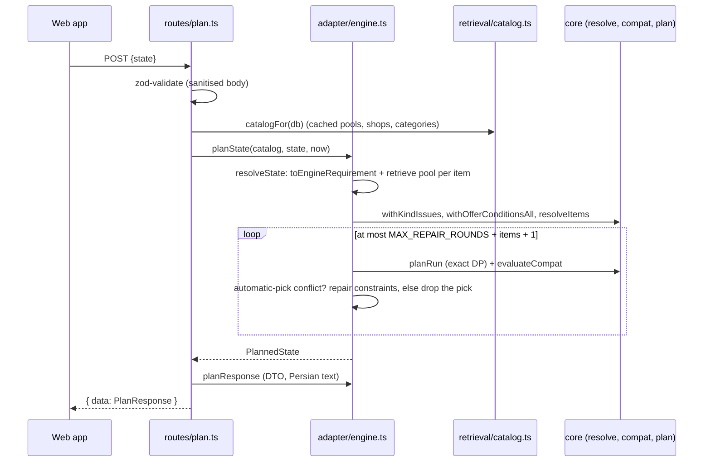

# Backend and recommendation engine: reference

How a request is handled on the server, and exactly how the engine turns a Persian sentence into a shopping plan.
Everything below was read from the code (paths are relative to the repository root) and checked against the real
database snapshot. Where the code does something surprising, or has a limitation, it says so.

Contents

1. [Principles and architecture](#1-principles-and-architecture)
2. [Request handling on the backend](#2-request-handling-on-the-backend)
3. [The state model](#3-the-state-model)
4. [The data layer](#4-the-data-layer)
5. [Parsing](#5-parsing-apiparse)
6. [Candidates, evaluation and item states](#6-candidates-evaluation-and-item-states-apiresolve)
7. [Questions](#7-questions)
8. [Compatibility](#8-compatibility)
9. [The planner](#9-the-planner-apiplan)
10. [A worked example with real numbers](#10-a-worked-example-with-real-numbers)
11. [The assistant](#11-the-assistant-apiassist)
12. [Failure modes and security](#12-failure-modes-and-security)
13. [Performance](#13-performance)
14. [Testing](#14-testing)
15. [Known limitations](#15-known-limitations)
16. [How to extend](#16-how-to-extend)

---

## 1. Principles and architecture

The product plans an in-person shopping run in Tehran's bazaar belt from a sentence like
«۴ دوربین داهوا ۲ مگاپیکسل، ضبط‌کننده ۴ کانال و هارد ۲ ترابایت و آداپتور». Four rules shape every design decision:

| Principle | What it means in code |
|---|---|
| **The deterministic engine decides.** | Retrieval, constraint evaluation, question choice, compatibility, planning and totals are pure TypeScript with no model in the loop (`packages/core`, `apps/server/src/adapter`, `retrieval`). |
| **The LLM only interprets words, and is optional.** | It may refine a parse and choose one assistant action from a closed set. It can never name a product, price, shop or total. With no key, a timeout or invalid output, the deterministic result is used. |
| **No false certainty.** | A suggested model is never labelled exact. Compatibility is `listing_stated`, `assumed` (our general rule) or `unknown`; there is no "verified" level. Totals always carry their coverage. Listing is not stock. |
| **The client holds the state.** | The server keeps no session. Every call carries the whole requirement state and the server recomputes from it. |

Repository map:

| Path | Role |
|---|---|
| `apps/server/src` | Fastify app: routes, adapter (wire <-> engine), retrieval (SQLite pools), parser, assistant, LLM client and gate. |
| `packages/core/src` | Pure logic shared by server and web: types, `requirement/` (evaluate, classify, offers, plausibility, nomatch), `questions/`, `compat/`, `plan/`, `api/` (DTOs and zod schemas), `extract/`, `normalize/`, `copy/` (all Persian text). |
| `scripts/data` | The offline data build (CSV -> `market.sqlite`) and quality gates. |
| `apps/web` | The React UI (consumes the DTOs; renders what the engine says, never recomputes it). |

---

## 2. Request handling on the backend

### 2.1 Start-up

`apps/server/src/index.ts` loads `config.ts`, which validates the environment with zod and defaults safely:

| Setting | Default | Notes |
|---|---|---|
| `PORT` | 8080 | |
| `DATABASE_PATH` | `<repo>/data/market.sqlite` | opened **read-only** (`db.ts`); a missing file gives a degraded "db: false" server, not a crash |
| `RATE_LIMIT` | 120 / min / client | `/api/*` only; static files are unlimited |
| `BODY_LIMIT_BYTES` | 16 KiB | larger bodies get 413 |
| `REQUEST_TIMEOUT_MS` | 10 s (CLI backend: LLM timeout + 5 s) | |
| `TRUST_PROXY` | 1 in production, else 0 | a hop-counting function, never a boolean (see 12) |
| `LLM_BACKEND` | `anthropic` if `LLM_API_KEY` is set, else `none` | `claude-cli` is a testing backend, refused in production unless `LLM_ALLOW_CLI_IN_PROD=1`, and binds loopback only |
| `LLM_TIMEOUT_MS` | 3000 (CLI: 20000) | |

After the server is listening, `warm.ts` pre-warms in the background (it never delays readiness): the plausibility
head statistics (one pass over every listing, about 2 s, built 10k titles per event-loop turn) and the candidate
pools of up to 12 demo categories. A decision request that arrives during the head pass finishes it synchronously.

### 2.2 Middleware order (`apps/server/src/app.ts`)

1. **Logger**: JSON, with method, path (query string stripped), status and timing only. Request/response bodies, headers and error messages are never logged.
2. **Framework errors** (`errors.ts`): bad URLs, malformed HTTP and parser errors still answer in the Persian envelope.
3. **Content types**: the `text/plain` parser is removed; only `application/json` bodies are accepted (others get 415).
4. **Security headers** (`onSend`): `X-Content-Type-Options`, `X-Frame-Options: DENY`, `Referrer-Policy: no-referrer`, COOP/CORP same-origin, a restrictive `Permissions-Policy`, a `Content-Security-Policy` (self only), `Cache-Control: no-store` on `/api/*`, HSTS in production. CORS is deliberately not enabled (same-origin app).
5. **Rate limit** (`@fastify/rate-limit`): per client, `/api/*` only.
6. **Error handler + body sanitiser** (`errors.ts`): every error leaves as `{error:{code,messageFa}}`; a `preValidation` hook cleans every string in every JSON body (`sanitizeDeep`: bidi overrides/isolates, direction marks, control and zero-width characters stripped; ZWNJ/ZWJ kept).
7. **Compression** (`web.ts`): brotli/gzip for text and JSON (1 KiB threshold); static assets are served pre-compressed (`.br`/`.gz` written at build by `apps/server/scripts/precompress.mjs`). Request-body decompression is off, so the body limit cannot be bypassed.
8. **Routes**, then the **web app** with SPA fallback and a static Persian page for 5xx on HTML requests.

### 2.3 Endpoints

All success responses are `{ data: ... }`. All errors are `{ error: { code, messageFa } }` with a Persian message and no echo of the path or input. DTOs and zod schemas live in `packages/core/src/api/dto.ts`.

| Endpoint | Input | Output | What it does |
|---|---|---|---|
| `GET /api/health` | none | `{status, db, llm, llmBackend?, uptimeSec, commit}` | Never exposes keys, paths or versions. Exempt from rate limiting. |
| `GET /api/meta` | none | snapshot date (ISO and Jalali), counts, `fictionalShopNames: true`, areas | Feeds the About sheet. |
| `POST /api/parse` | `{text}` (max 500 chars) | `{items[], notes[], preference?, totalBudget?, source, degraded?}` | Text -> parser items (section 5). |
| `POST /api/resolve` | `{state}` | per-item state, counts, price range, next question, flags | The item cards (sections 6-8). |
| `POST /api/plan` | `{state}` | stops, totals with coverage, compat lines, alternatives, items | The shopping run (section 9). |
| `POST /api/options` | `{state, itemId, productId?}` | models (sorted by price, with differences) or all sellers of a product | The "change" sheet. |
| `POST /api/assist` | `{state, text? | chip?, context?}` | `{action, newState, changed, messageFa, source, degraded?}` | One closed action applied to the state (section 11). |

Limits (`API_LIMITS`): 12 items per state, 12 chips, 500 characters of text, 64-character ids, 16 answers per item, 24 constraints per item, 50 excluded shops per item. At most `MAX_PLAN_ITEMS = 8` items with priced offers are planned (the 9th is reported as missing, not an error).

### 2.4 One request, step by step (`/api/plan`)

---

## 3. The state model

The client sends the same object to `/api/resolve`, `/api/plan`, `/api/options` and `/api/assist`
(`RequirementStateSchema`, `packages/core/src/api/dto.ts`):

| Field | Meaning |
|---|---|
| `requirements[]` | Parser items **verbatim** from `/api/parse` (text, qty, `categoryIds`, `constraints`, `modelCode`, `budget`, `kind`, `inherited`...). |
| `answers[itemId][questionKey]` | The user's answers. The value is an option id: `c~<op>~<attr>~<json>` for a constraint (e.g. `c~eq~camera_signal~"hdcvi"`), `b~<min>~<max>` for a budget band, or `any` for «فرقی نمی‌کند». Decoded by `packages/core/src/api/answers.ts`; anything undecodable is ignored, not rejected. |
| `settled[itemId]` | «کافیه، پیشنهاد بده»: stop asking, take the suggestion. |
| `pins[itemId]` | A product id the user picked: the item becomes «مدل مشخص». |
| `shopPins[itemId]` | A seller the user picked for the item. |
| `excludedShops[itemId or '*']` | Shops excluded for one item or for every item. |
| `variant` | Which plan alternative is active (`null` default, `'fewest'`, `'stops:N'`). |
| `visit` | `{day, window}`: weekday and optional time window; default today, any time. |
| `preference` | `'cheapest'` or `'fewest_stops'` from the parser's words. |

**Derived constraints are never stored.** Compatibility rules add constraints (for example `channels >= 4` on the
recorder) every call; `stripDerived` removes them so only the user's own statements persist. This keeps old saved
plans correct when a rule changes.

**User reports** («موجود نیست», «قیمت فرق دارد») live only in the browser, are not part of this state, and never enter
a dataset total. The web turns a report into `excludedShops` (so the plan is recomputed without that shop).

---

## 4. The data layer

The database is built offline by `scripts/data` from the three CSVs and opened read-only by the server
(`docs/DATA_SCHEMA.md` is the schema contract). Key facts from `data/quality-report.json` (snapshot 2026-10-13):

| Fact | Value |
|---|---|
| Products / offers / shops | 225,903 / 331,506 / 6,476 (3,792 shops have at least one offer) |
| Categories | 3,988 (3,428 have products); 117 hand-written synonyms |
| Database size | 130.5 MB; full-text query p95 about 6.5 ms |
| Price rules | `price = NULL` when the raw price is missing, below 10,000 or above 10^12 toman; flags: `missing` 15,083, `placeholder` 5,062, `outlier` 126 |
| Hours | 23,390 `00:00-00:00` sentinel shifts dropped; missing hours stay NULL, never "closed"; 64 shops that declare a 24-hour Friday while all other days are normal are read as **unknown** on Friday (a placeholder pattern: 7 % of such shops vs 0.6 % for any other weekday) |
| Mall/floor/unit parsed from addresses | for shops with offers: 64 % / 69 % / 75 %; 501 mall buildings |
| Privacy | no phone numbers, social handles or websites exist in the database |

Tables used by the engine: `products` (title, category, brand, `attrs` JSON, model codes, min price, offer and seller
counts), `offers` (price, price flag, seller title only when different, warranty, last change), `shops` (position,
`building_key`, parsed mall/floor/unit, hours as minutes per weekday), `categories`, `synonyms`, and the FTS5 table
`products_fts` (an FTS5 index with external content over the view `products_fts_src`: the index holds the normalised tokens of the title, seller titles, brand and model codes, while reading the text column returns the product title; read-only, never rebuilt at run time).

**Attribute extraction** (`packages/core/src/extract`): per-domain, title-based extractors fill `attrs` with only
the values they are confident about; unreadable means absent, never guessed. Coverage of each attribute is reported
per domain (for example recorders: type 91 %, channels 87 %; internal drives: capacity 94 %; cameras: megapixels
59 %, signal type 50 %; adapters: volts 77 %, amps 77 %; wire: section 85 %, but sale unit only about 29 %;
phone accessories: compatible models 77 %). Brand is known for only 28.8 % of products overall. The labelled
accuracy check (675 hand-labelled titles) has 0 wrong values; errors resolve to "unknown". See
`packages/core/src/extract/ATTRIBUTES.md`.

**Offer-level condition flags.** A product title may say nothing while one seller's own listing title says
«های کپی» or «استوک». `detectListingFlags` runs the same detector on every offer's seller title at query time, so
no rebuild is needed (section 6.4).

---

## 5. Parsing (`/api/parse`)

`apps/server/src/parse/parse.ts`; no LLM is needed. Pipeline per request:

1. **Normalise** (`normalizeFa`): Arabic ي/ك to ی/ک, Arabic/Persian digits unified, ZWNJ unified, bidi/control characters stripped.
2. **Split** into segments (`split.ts`) on «،» «,» «؛» newline «+» and «و», but never inside a number phrase or a model code: «دو و نیم» stays one value.
3. **Per segment**, cut out and read: budget phrases (`budget.ts`: «زیر ۵ میلیون», «تا ۳ میلیون», «حدود ۲ میلیون»; budgets are per unit, in toman, inclusive), preference words («نزدیک», «کم توقف», «ارزان»), and the quantity (`phrases.ts`: digits, «×۴», «۴ عدد», number words from «یک» to «ده», tens, hundreds, «هزار», «دوجین»; «نیم» as .5; metres carry an exact `qtyExact` while `qty` stays an integer).
4. **Model code** (letter+digit codes like `XVR1B04-I`) and **category vote** (`category.ts`): hand-written synonyms plus the category frequency of the top 200 full-text hits. A category reached only through full-text hits must share at least one exact word with the request (coherence), which is how «برنج هاشمی» ends up absent while «شیر برقی» resolves. Food homonyms (شیر, برنج, مرغ) alone are forced absent. Name coverage beats synonyms; the head noun of the request gets a 1.4x boost.
5. **Constraints**: the same domain extractors used on titles are run on the item text and mapped to the engine's closed attribute schema (`ATTR_SCHEMA`) by `adapter/mapping.ts`.
6. **Kind** (camera, recorder, hdd, adapter, phone, phone_case, screen_protector, wire, other), brand, notes, confidence.
7. **Context linking**: an accessory with no phone model inherits it from the phone item in the same request (marked `inherited`, editable).

A request whose item resolves to no coherent category gets `categoryIds: []` and the note `not_in_catalog`. This is
**authoritative**: the item stays terminal "پیدا نشد" and is never searched by raw text (`retrieve.ts`, `noVote`).

**LLM refinement hook** (`routes/parse.ts`, `parse/refine.ts`, `llm/refiner.ts`): when a backend is configured, the
LLM refinement is raced against `LLM_TIMEOUT_MS`. It receives the draft, the text and a **shortlist** of allowed
categories and the closed constraint schema; its JSON is validated with zod (categories from the shortlist, 1-12
items, closed attribute keys). On timeout, throw or invalid output the deterministic result is returned with
`degraded: true` (`degradedReason` is returned by `/api/assist` only; `/api/parse` carries just `degraded`). A late answer is dropped for good and
never swapped in afterwards.

---

## 6. Candidates, evaluation and item states (`/api/resolve`)

### 6.1 Retrieval (`retrieval/retrieve.ts`, `catalog.ts`)

For each item the pool is **every product with offers in the item's categories** (bounded at 6,000 per category; the
largest demo category, wire, has about 5.3k), cached in memory after the first load. Words of the item text that nothing
else explains (not a quantity, a stated chip, or the category's own words) narrow the pool with full-text search
(AND, bm25); if nothing matches the words are ignored. A typed model code and a pinned product are always added even
when they fall outside the bounded pool. Only constants reach SQLite as text; user input is bound parameters or a
quoted FTS query built by `buildFtsQuery`.

### 6.2 Plausibility (`requirement/plausibility.ts`)

"Cheapest eligible" is only honest if the listing is the right kind of thing and its price fits its sale unit. Three
structural rules mark a listing instead of hiding it (it stays in the options list as «جایگزین» or «مشخصات کامل نیست»):

1. **Title head**: the first goods word of a title must not be a word that is rare in this category (under 5 % of its titles; the audit measured established names at about 8 % or more of a category's titles and foreign heads at 0.1-1.3 %, so the cut sits in a gap) and common in another one («فیش آداپتور» is a plug, not an adapter).
2. **Sub-kinds** of mixed categories (hand-written table, six categories): if the request names one type, listings of another type differ.
3. **Sale unit vs price** for wire: prices are converted to per-metre by the stated unit and compared with the group median; an offer more than about 4.6x away (the cube root of 100, a third of the gap between a roll and a metre) is dropped, and a listing with no consistent price becomes incomplete.

### 6.3 Constraint evaluation (`requirement/evaluate.ts`)

Each stated constraint is evaluated per product as **pass**, **fail** or **unknown**; unknown whenever the product lacks the
attribute (`evaluateConstraint`). Operators: `eq`, `in`, `gte`, `lte`, `contains` and `known` (passes only if the
attribute is readable; used by rules so that skipping a question cannot auto-pick an unreadable product). Device
models compare as variants (`galaxy s24` is not `galaxy s24 ultra`; a trailing `5g` is ignored only if exactly one side
states it). A model code matches on normalised tokens, also with a vendor prefix of at most 3 characters when the
shorter code has at least 5 characters (`DH-XVR1B04-I` ~ `XVR1B04-I`).

`evaluateCandidate` gives each product a **fit**:

- `differs`: a constraint failed, or the price is outside the budget, or the model code mismatches, or the condition does not fit, or a plausibility "other kind" issue exists.
- `incomplete`: nothing failed but a constraint is unknown (or the sale unit is unclear).
- `eligible`: everything passes.

### 6.4 Condition and offers (`requirement/offers.ts`)

The accepted condition of an item is `new` (default), `any`, `used` or `replica` (set by words like «استوک» or the
answer `c~eq~condition~"any"`). Replicas are never accepted unless asked for. A title without a flag means
**"not stated as used"**, not "new". The rule is applied to every **offer** on the union of the product's flags and
the offer's own flags, before anything reads prices: unaccepted offers move to `conditionExcludedOffers`, so they are
never the cheapest price, never counted as sellers, never in price ranges or budget quantiles, never in a plan stop.
If every offer of a product is set aside the product itself becomes a flagged listing. A pinned product is taken as is
(and a flagged offer is planned only if the user pinned both the product and that shop).

### 6.5 Classification (`requirement/classify.ts`), in this exact precedence

| # | Condition | State | Counted in totals |
|---|---|---|---|
| 1 | a product is pinned | `exact_model` (or `price_unknown` if unpriced; `not_found` if the product vanished) | yes if priced |
| 2 | the typed model code matches an eligible-condition product | `exact_model` (cheapest priced match) | yes |
| 3 | no candidates | `not_found` | no |
| 4 | a priority-1 (compatibility-critical) question is open | `needs_info` | **no** |
| 5 | the requirement is loose (no stated spec, budget or code) and a question exists while eligible products exist | `needs_info` | **no** |
| 6 | some eligible product is priced | `suggested`: the **cheapest eligible**, within budget when one is set (`cheapest_eligible[_within_budget]`) | yes, flagged "with suggested models" |
| 7 | eligible exist but none is priced | `price_unknown` | no |
| 8 | nothing eligible | `alternative` (a differing product is auto-picked only if the user allowed alternatives, and only one with no unknowns) | only if picked |

Never auto-picked: any product with an unknown on an attribute a rule or the user needs, any used/refurbished/replica
listing, any product flagged by plausibility. These stay visible in `/api/options`. Suggestion tie-break order:
cheapest, then more priced offers (plan feasibility), then product id. A suggestion is **never** labelled exact.

When nothing is eligible, `requirement/nomatch.ts` builds the `noMatch` object: a Persian reason that quotes data
values (for example «هیچ مدلی با بودجهٔ ۵۰ میلیون پیدا نشد؛ ارزان‌ترین مدل ۱۰۰٫۶ میلیون تومان است»), the stated
conditions the user can relax (`budget`, `condition` or an attribute), and up to three nearest differing models.

For `not_found` items, `retrieval/notfound.ts` suggests categories **only with lexical evidence** (a full synonym term,
two shared meaningful words, or one rare head-noun word). Without evidence it returns the biggest real categories
under the label «چیزهایی که در این فهرست دارم», never a guess.

---

## 7. Questions

`questions/next.ts` returns at most one question per item per call; the client re-resolves after each answer. The
policy is **few questions, each one worth asking** (audit: `docs/AUDIT-questions.md`). Each is skippable («فرقی
نمی‌کند»), and «کافیه، پیشنهاد بده» (`settled`) ends questioning:

1. **Mandatory rules** (only the wire sale unit): asked even after skip or settle, because roll and per-metre prices cannot be compared.
2. If the item is settled, stop (`accepted_default`).
3. **Compatibility-critical unknowns** (priority 1): the camera's signal type before a recorder, the adapter voltage, a phone model for an accessory. Always asked, outside the cap below; an option that keeps no model is never offered.
4. If the eligible list fits one phone screen (`maxListSize`, default 8), stop (`fits_one_screen`).
5. **Cap**: at most `MAX_QUESTIONS_PER_ITEM = 2` questions per item. Every question already shown counts (an answer, a «فرقی نمی‌کند», a budget band; the adapter passes the answered keys as `answeredQuestions`), compat ones included, so a third question only happens when a compatibility question becomes necessary later. Then stop (`question_cap`).
6. **Candidates**: facets (priority 2) and budget bands (priority 3), never an attribute the user stated, a rule derived, or one already asked.
   - A facet offers only **meaningful options** (each keeps at least 2 models and 2 % of the eligible pool), at most 6; fewer than two is no question. The offered options must cover at least 50 % of the eligible models (models a sibling rules out, such as IP cameras next to a stated DVR, are not counted; a key facet, below, has no coverage floor).
   - Budget bands: tertiles of the eligible products' real minimum prices when there are at least 9 (else the median), rounded to friendly numbers (`niceRound`: 1, 1.2, 1.5, 2, 2.5, 3, 3.5, 4, 5... times powers of ten), empty bands merged away.
7. **Information value** (`informationValue`), from the eligible models, weighting each option by its size:
   - *pool narrowing* = (1 - Σ share²) x coverage: the expected share of models an answer separates;
   - *spread narrowing* = (1 - Σ share x ln(max/min) of the option / ln(max/min) of the pool) x coverage: how much an answer tightens the price range.
   Coverage (the share of eligible models the options cover) discounts both, so a split that only hides unreadable listings is not information. A question below **15 % pool narrowing and 20 % spread narrowing** is not asked (`low_value` when nothing else is left).
8. **Order**: the **key facet** of the item's role first (`KEY_FACETS`: analog vs IP for a camera, recorder type, adapter voltage, wire section), kept even when it narrows little or half the listings do not state it, but still priority 2 (it does not block the suggestion); then by value = max(pool, spread narrowing), biggest first. The budget question competes on the same value.

Every question carries one line **why** («چرا می‌پرسم»; `questionWhy` in `copy/fa.ts`; compat questions use their
rule's line), and every option a **consequence hint**: the models it keeps and the cheapest eligible price among them
(`QuestionOption.minPrice`, rendered by the adapter as «۱۸۷ مدل · از ۱٫۲ میلیون»; budget bands show the count only).
Options that would contradict something the user already fixed on a related item are not offered
(`answerAllowed`; for example a stated DVR removes the IP-camera option). Question text is templated Persian
(`packages/core/src/copy/fa.ts`), not generated.

---

## 8. Compatibility

Only two domains have rules: CCTV and phone accessories (plus the wire sale-unit rule).
`packages/core/src/compat/rules.ts`. A rule can derive constraints for sibling items **from stated requirements only**,
report critical unknowns, and evaluate the finally chosen products into findings:

| Status | Meaning | UI |
|---|---|---|
| `listing_stated` | both listings state it (for example a recorder listing says 8 channels) | neutral chip |
| `assumed` | a general rule we encode, not verifiable from the data | outlined chip, "تأیید نشده" |
| `unknown` | an attribute is missing | amber dot |
| `conflict` | the listings contradict the requirement or the general rule | amber marker |

There is no "verified" level and no green tick, by design.

| Rule id | Relationship | Result |
|---|---|---|
| `recorder_channels` | recorder channels >= total camera quantity | `listing_stated` when channels are read, `conflict` if too few, `unknown` if unreadable |
| `camera_recorder_signal` | analog family (AHD/HDCVI/TVI/analog) -> XVR or DVR; IP -> NVR | `assumed` for the fitting pairs (IP on XVR is also `assumed`, with its own sentence), `conflict` otherwise, `unknown` if a side is unreadable |
| `recorder_hdd_internal` | a recorder needs an internal SATA drive | always `assumed` |
| `hdd_surveillance` | the drive is surveillance-grade (Purple, SkyHawk...) | `listing_stated` if flagged in the listing, else `unknown` |
| `camera_adapter_12v` | cameras usually use a 12 V adapter | derives `voltage_v = 12` for the adapter unless the user stated another voltage; `assumed` for 12 V, `unknown` if the user lifted the assumption |
| `camera_adapter_current` | adapters must supply the cameras' total current (2+ cameras) | always `unknown`: no listing states a camera's current. Never a conflict, never blocks selection. Quotes the adapter's stated amps. |
| `phone_accessory_fit` | the accessory's compatible models contain the phone model | `listing_stated`, `conflict` (an explicit other model), or `unknown`; an A57 case is excluded for an A56 phone with the reason |
| `wire_sale_unit` | wire needs a known sale unit (roll vs metre) | critical, mandatory question |

**The guard** (`adapter/engine.ts` `planState`). A `conflict` must never sit beside an automatic pick:

1. Plan, evaluate compat on the chosen products.
2. If a conflict involves an auto-picked item, add the rule's **repair constraints** (for example "recorder kind in XVR/DVR") and re-resolve, up to 3 rounds. The conflicting products become «جایگزین» with the reason and the next eligible product is picked.
3. If repairs cannot remove it, **drop the pick**: the item becomes "نیاز به اطلاعات" with the conflict sentence and is not counted.
4. Alternative plans that would contain such a conflict are hidden.

A conflict the user caused (two statements, or a statement and a pin) stays visible, says "(از انتخاب‌های خودت)", and makes
the plan carry `hasConflict` plus the marker «ناسازگاری دارد»; the plan reason drops any superlative. If the user lifts
the 12 V assumption the finding is `unknown` and the marker is «بدون تأیید سازگاری».

Each finding carries `askSeller` text, phrased per role (a camera seller is asked about the recorder, not the other
way round: `askSellerByItem`), which appears on the "show to seller" card.

---

## 9. The planner (`/api/plan`)

`packages/core/src/plan/optimize.ts`, an exact solver for small problems.

**Model.** A **stop is a building** (`building_key`: the parsed mall when present, else coordinates rounded to
about 11 m). For every (building, item) the price is the **cheapest valid offer times quantity**; valid means priced,
shop known, not excluded and not closed at the visit time. **A shop with no known hours is never treated as closed.**
One item is bought at one stop (quantity is never split; stock is unknown).

**Algorithm.** With m <= 8 plannable items, let `f[j][k][mask]` be the minimum cost to buy exactly `mask` using exactly k
of the first j buildings, each used building buying a non-empty subset (subset DP over buildings, sub-masks and stop
counts, roughly `O(N x K x 3^m)`; measured about 11 ms for 6 items over 300 buildings and about 70 ms for 8 items).
Then:

1. **Coverage first**: pick the largest coverable item set (ties by cost).
2. **Pareto set** over (total cost, number of stops) for that coverage: for each k keep it only if it is strictly cheaper than every plan with fewer stops. A plan that is not strictly better is never shown.
3. **Ties** at equal (cost, stops) are broken by compactness (smaller maximum pairwise haversine distance), then by sorted building keys. At most 5,000 tied building sets are inspected (`tieEnumerationTruncated` reports a hit).
4. **Default plan**: the user's stated preference (`fewest_stops`, `compact`), otherwise the cheapest at maximal coverage. There is no tolerance constant.
5. **Stop order**: nearest-neighbour starting from the "densest" stop (smallest sum of distances to the others), by straight-line haversine distance. It is labelled a suggested order, never a route; no walking times are claimed.

**Output.** Ordered stops (grouped by building, with each shop's mall/floor/unit, hours text and open status), the
assignments, totals, alternatives with true deltas, reasons and notes.

- **Totals always carry coverage**: complete -> «جمع ۴ مورد: ۲۰٫۳ میلیون تومان»; partial -> «فقط ۳ از ۴ مورد: …» plus a missing line grouped as «پیدا نشد» / «منتظر انتخاب» / «قیمت ثبت نشده». Partial plans never get superlative wording (`cheapest`, `fewest_stops` tags are only set for complete plans).
- **Alternatives** are the other non-dominated plans, labelled truthfully (for example «۱ توقف · ۴٫۷ میلیون تومان بیشتر») with `stopCount` and a delta; with one possible plan the notes say why (for example "this item has only one seller").
- **Closed shops** at the chosen visit time are excluded and counted in a note; open status uses the weekday and time window (`plan/hours.ts`).
- **Variant consistency invariant**: for every plan variant, `items[i].product` equals the product on its stop line, and the total equals the sum of the lines. A property test checks this over five scenarios and every variant on the real database.
- A single-shop line appears only when one shop carries every item.

---

## 10. A worked example with real numbers

Request (against the running server and the real database): «۴ دوربین داهوا ۲ مگاپیکسل، ضبط‌کننده ۴ کانال و هارد ۲ ترابایت و آداپتور».

**Parse** produces four items: `i1` camera, qty 4, `resolution_mp = 2`, `brand = dahua`; `i2` recorder, `channels = 4`;
`i3` hdd, `capacity_tb = 2`; `i4` adapter with no constraints.

**Resolve** (about 50 ms): `i1` is "پیشنهاد" (cheapest eligible Dahua 2 MP camera) with an open question
«دوربین آنالوگ باشد یا تحت شبکه؟» (HDCVI: 140 models from 1.2 M, IP: 117 from 2.5 M; the 3 listings that only say
«آنالوگ» are too few to be an option); `i2` is "نیاز به اطلاعات" because the recorder
type depends on the camera type; `i3` is "پیشنهاد"; `i4` is "نیاز به اطلاعات" with the 12 V assumption question.
Note how rules shaped this: `recorder_channels` already derived `channels >= 4` on the recorder from the stated camera quantity.

**After answers** (camera = HDCVI, recorder = XVR/DVR, adapter = 12 V) every item is "پیشنهاد" and **plan** returns, in about 30 ms:

- Total «جمع ۴ مورد: ۲۰٫۳ میلیون تومان» over 4 stops (tapping the first option of every question, including budget bands, gave ۲۰٫۸ میلیون: a different budget band picks a different cheapest model).
- Six compat lines: `recorder_channels` listing_stated ("ضبط‌کنندهٔ ۴ کاناله برای ۴ دوربین"), `camera_recorder_signal` assumed, `recorder_hdd_internal` assumed, `hdd_surveillance` listing_stated, `camera_adapter_12v` assumed, and `camera_adapter_current` **unknown** (the picked adapter's listing says 0.5 A and nothing states what four cameras draw).
- Alternatives (all non-dominated): 3 stops for ۱۴۰ هزار تومان more, 2 stops for ۱٫۸ میلیون more, 1 stop for ۴٫۷ میلیون more.
- In the budget-band run the stops were: پاساژ یگانه (recorder, 5.3M), پاساژ علاالدین دوم (internal drive, 10.4M), پاساژ نادری (4 cameras at 1.22M each = 4.88M), پاساژ افق (12 V 1 A adapter, 215k).

Everything printed above is data from the database or a templated sentence; no number came from a model.

---

## 11. The assistant (`/api/assist`)

`apps/server/src/assist/`. Free text and chips become **one closed action that edits the requirement state**; the
plan is then recomputed by the normal route, and the web shows the difference with an Undo. The assistant never edits a
plan.

Decision flow (`service.ts`):

1. A chip (`cheaper`, `closer`, `fewer_stops`, `only_open`, `without_shop`) -> deterministic action.
2. Text that exactly matches a chip phrase -> deterministic action, **no LLM call**.
3. Otherwise, if the LLM is usable: the LLM chooses an action (raced against the timeout; a late answer is discarded).
4. Otherwise, or on any failure: the keyword matcher (`keywords.ts`), else a calm Persian "unsupported" message.

Actions (`assist/types.ts`): `set_preference`, `exclude_shop`, `exclude_mall`, `only_open`, `swap_brand`,
`relax_constraint`, `set_budget`, `add_item` (through the deterministic parser), `remove_item`, `set_spec`,
`explain`, `none`. `set_spec` (changing a stated capacity, megapixels, channels, power or wire section, with a size
ladder for "bigger") is **not offered to the LLM**, so the model never supplies the numbers. Every id is validated
against a plan recomputed from the supplied state; unknown ids make the assistant ask the user to choose
(`choices`). `exclude_mall` adds the shops of that building among the planner's current candidates (it refuses above 50).

Messages are templated Persian filled from validated fields. Free LLM prose is shown only for `explain` and
unsupported requests, and only after a post-check (`guard.ts`) that rejects: numbers not supplied by the data or the
user, money/magnitude words, stock or guarantee claims, URLs, emails, phone-like digit runs, markup, id-like tokens,
unknown Latin words, mostly-Latin text, and any 24+ character echo of the system prompt.

**LLM gate** (`llm/gate.ts`): per-client per-minute and per-UTC-day limits, a global daily cap and a concurrency cap,
all in memory per process; a circuit breaker opens after repeated failures; an over-budget or open breaker answers
deterministically with `degraded: true` (and, on assist, a `degradedReason`). Prompts treat user text and listing titles as untrusted
data; bidi and control characters are stripped before anything reaches a model. The `claude-cli` backend (`llm/claude-cli-client.ts`) runs
`claude -p` for **local testing only**: no shell, prompt on stdin, tools disabled, a private empty working directory and
a minimal environment, loopback binding, and a per-call check that the CLI reports no tool use.

---

## 12. Failure modes and security

| Situation | Behaviour |
|---|---|
| No LLM key / timeout / bad output / budget spent / breaker open | Deterministic parse and keyword assistant; `degraded` on both routes, plus a `degradedReason` (`not_configured`, `failed`, `budget`) on assist so the UI can word "not configured" and "failed" differently. |
| Database missing | `/api/health` reports `db: false`; decision routes answer with a Persian `DB_UNAVAILABLE`. |
| Malformed input | 400 `INVALID_JSON` / `BAD_REQUEST`; 413 above 16 KiB or 500 characters; 415 for non-JSON; 404 for unknown routes (no path echo). |
| Rate limit | 429 with `retry-after`; assist and LLM paths have their own stricter limits. |
| Server error on an HTML request | A static Persian fallback page. |
| Client offline | The UI shows the saved plans from local storage; a service worker (secure origins only) serves the shell. |

Security controls and residual risks are in `docs/SECURITY.md`. In short: parameterised SQL only, a body sanitiser on
every request, a strict CSP and headers, same-origin only, no secrets or bodies in logs, per-client rate limits that
key IPv6 by /64 and count only the configured number of proxy hops, a documented BREACH note for compression, and
injection tests (hostile listing titles, fake ids, prompt-leak attempts). Residual: text inside shop or mall names can
steer a model to a valid-but-different action (the user sees the change and can undo it).

---

## 13. Performance

Measured on this snapshot (warm in-memory pools): resolve and plan have a p95 of tens of milliseconds locally (typically
15-40 ms); the first call touching a category loads its pool (about 120-160 ms); the plausibility head pass after start-up
takes about 2 s (so a plan requested within roughly 2 s of boot can take about 2.2 s once). Over a real network to the
deployed VPS the round trip is dominated by latency, not computation. Compression takes the main JavaScript bundle
from about 310 KB to about 84 KB (brotli).

---

## 14. Testing

| What | Where | How to run |
|---|---|---|
| Unit and API tests (about 1,270, including real-data suites) | `packages/core`, `apps/server/test`, `scripts/data`, `apps/web` | `npx vitest run` (real-data tests need `data/market.sqlite` or `DATABASE_PATH`; timeouts are 30 s so a busy machine does not flake them) |
| Real-data end-to-end (browser, 390 and 360 px) | `apps/web/e2e-real` | `npm run e2e:real -w @app/web` |
| Conflict / honesty sweep | `apps/server/scripts/sweep-conflicts.ts` | `npx tsx apps/server/scripts/sweep-conflicts.ts`: 44 lists x 6 answer strategies x variants; exits non-zero if any must-be-zero counter rises (conflict beside a total without marker, auto-picked conflict, superlative beside a conflict, card != stop line, total != sum, absent item picked) |
| Suggestion audit | `apps/server/scripts/audit-suggestions.ts` | `npm run audit:suggestions -w @app/server` (needs `DATABASE_PATH`); report in `docs/AUDIT-suggestions.md` |
| Question audit | `apps/server/scripts/audit-questions.ts` | `npm run audit:questions -w @app/server` (needs `DATABASE_PATH`); report in `docs/AUDIT-questions.md` |
| Data gates | `scripts/data` | `npm run data:check` (join integrity, no contact data, price and hours rules, size) and `npm run labels -w @app/data` (label precision) |
| Deploy smoke | `deploy/smoke.sh` | `deploy/smoke.sh <base-url>` |

---

## 15. Known limitations

- **The suggestion rule is "cheapest eligible".** It is visible and honest, but a cheapest model can be a poor one; when the pool is wide the user is asked up to two questions (usually the budget and the strongest facet) first.
- **Facets exist only where an extractor does**: outside CCTV, phones and wire most items can only be asked brand and budget (laptops have no RAM/storage facet; see `docs/AUDIT-questions.md`).
- **The first-word plausibility rule has a trade-off.** It sets aside a few real 12 V power supplies titled «پاور آداپتور» and some «شارژر ۱۲ ولت» listings (they stay in the options list as alternatives).
- **Compatibility rules are general assumptions** (CCTV and phone accessories only), written by hand and not reviewed by a domain expert; nothing outside those domains gets a compatibility claim.
- **Attribute coverage is partial**: for example camera signal type is readable for about 50 % of cameras, wire sale unit for about 29 % of wire, brand for 28.8 % of all products. Unreadable means unknown, and unknown is never auto-picked where a rule needs the attribute.
- **Condition detection is title-based.** "Not flagged" means "not stated as used or a copy", not "new". Glued words («دست دومNikon») and English "Second" are missed on purpose rather than guessed.
- **Four sweep cases** show the conflict marker where an "unverified" marker would also apply; the conflict marker wins.
- **`exclude_mall` is implemented as a set of shops** among the current candidates, not a persistent mall exclusion.
- **At most 8 items with priced offers are planned**, and one item is bought at one stop.
- **Stock is unknown.** Every price is a dated listing; the UI states this once per plan.
- **Data limits**: a one-week-old snapshot, roughly 10 % of Tehran's shops (the organisers' figure, not checkable from the data), shop names are fictional, and about 31 % of all shops (21 % of those with offers) have no usable hours.
- **Stop order and distances are straight-line**; no routes, no walking times.
- **Plain HTTP deployment**: the offline service worker and clipboard API need a secure origin; the UI has fallbacks.
- **Known small issues**: a mall name written with a Latin digit versus an ordinal word may appear as two stops (a normaliser exists in `apps/server/src/mall-key.ts` but is not yet wired into the adapter); a few common words are not mapped to categories («وب کم», «کارت حافظه», bare «نوت بوک»).

---

## 16. How to extend

- **Add a product domain**: write an extractor in `packages/core/src/extract/domain-extractors.ts`, register the category routing in `extract/domains.ts`, map its keys to engine keys in `apps/server/src/adapter/mapping.ts`, add labelled titles to `scripts/data/labels/` (wrong values must stay at zero), rebuild the data (`npm run data:build`) and re-run `data:check`.
- **Add a compatibility rule**: add an entry to `COMPAT_RULES` in `packages/core/src/compat/rules.ts` (id in the `CompatRuleId` type, `derive` from stated requirements only, `critical`, `evaluate`, and a `repair` if it can conflict), add its Persian sentences and per-role questions in `copy/fa.ts`, and extend `sweep-conflicts.ts` lists. Use `assumed` for anything you cannot read from a listing.
- **Add an assistant action**: extend `assist/types.ts`, validate ids in `assist/apply.ts`, add keywords in `assist/keywords.ts` and the Persian message in `assist/messages.ts`; add it to the LLM schema only if the model should be allowed to choose it (numbers must never come from the model).
- **Change a threshold**: prefer structural rules over constants. Every constant that exists (price hygiene limits, the 5 % title-head share, the roll/metre tolerance) is documented where it is defined and in the audit.
